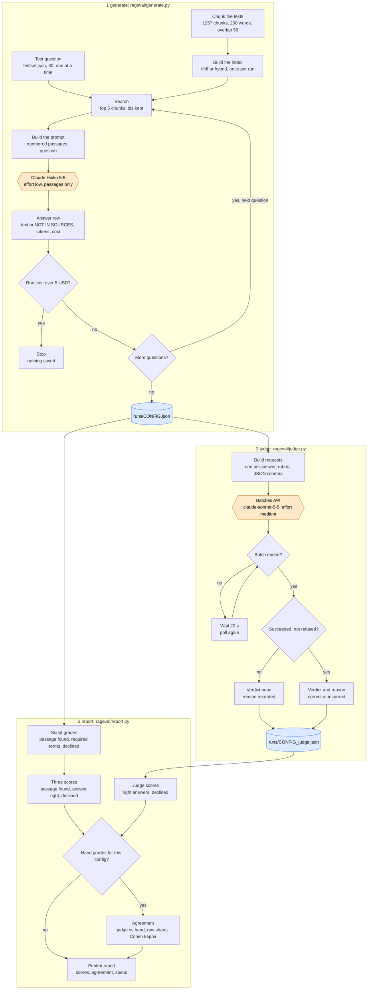

# rag-eval: does a small RAG pipeline on EU sustainability law tell the truth?

> **Part of a series on RAG over EU sustainability law:** [rag-from-scratch](https://github.com/batutho-dot/rag-from-scratch) (retrieval built by hand) → **rag-eval** (measured: three scores and a Claude judge) → [rag-claude-citations](https://github.com/batutho-dot/rag-claude-citations) (API-native: citations and caching)\
> This is part 2. It scores the pipeline from [rag-from-scratch](https://github.com/batutho-dot/rag-from-scratch); next, [rag-claude-citations](https://github.com/batutho-dot/rag-claude-citations) drops the hand-built search for the Claude API.

**Question:** when a retrieval-augmented pipeline answers questions about the EU Taxonomy,
the CSRD and the ESRS, how often does it (1) find the passage that holds the answer, (2) give
the right answer, and (3) say "not in the sources" when the texts cannot answer? And can a
second model, used as a judge, grade the answers as well as a person does?

This repo evaluates the pipeline from
[rag-from-scratch](https://github.com/batutho-dot/rag-from-scratch) (same author) and tests
one change to it.

**Answer (30 questions, one run per config, 2026-11-19):**

| Config | Right passage found | Right answer given | Unanswerable declined | Spend |
|---|---|---|---|---|
| baseline (TF-IDF) | 15 / 20 | 17 / 20 | 9 / 10 | 0.041 USD (answers + judge) |
| **hybrid (kept)** | **17 / 20** | **20 / 20** | **10 / 10** | 0.040 USD (answers + judge) |

The Claude judge agrees with the author's hand grades on **22 of 24** baseline answers
(92 %, Cohen's kappa 0.70). Hybrid search is kept: it is better on all three scores.

The test set has since grown to **40 questions** (29 answerable, 11 unanswerable). On all 40,
right passage found is **21 / 29** for baseline and **25 / 29** for hybrid (no model
involved). The answer, refusal and judge scores above are still from the first 30 questions:
the 10 new ones have not been sent to Claude yet.

## The ideas, in plain words

- **RAG** (retrieval-augmented generation): search the documents for the few passages most
  like the question, then let a language model answer from only those passages.
- **Three scores**, so a failure can be traced to its step:
  1. *Right passage found*: one of the 5 retrieved chunks contains an accepted evidence
     passage. If not, the model never saw the answer: a retrieval failure.
  2. *Right answer given*: the answer contains every required term from the reference
     answer and does not decline. A miss here with the passage found is a generation failure.
  3. *Unanswerable declined*: for questions the texts cannot answer, the model replies
     `NOT IN SOURCES` instead of inventing something.
- **Judge:** a second, stronger model grades each answer against the reference answer and
  the source passage, like a teacher marking against an answer key. Keyword checks miss right
  answers in other words; a judge can catch those, but it can also be wrong, so it is checked
  against hand grades.
- **Batch:** the judge's requests go to Anthropic's Message Batches API in one go. They are
  processed within 24 hours (usually minutes) at half the normal price.
- **Agreement:** the share of answers where the judge and the hand grade say the same thing,
  plus Cohen's kappa, which removes the agreement two graders would reach by chance
  (1 = perfect, 0 = no better than chance).

## Run it

Tested on Python 3.13 (Windows 11). From the repo folder:

```bash
python -m venv .venv
.venv/Scripts/activate        # Windows; on macOS or Linux: source .venv/bin/activate
pip install -r requirements.txt
python run.py download        # the three EU texts from EUR-Lex into data/ (about 6 MB)
python run.py                 # print the scores from the saved runs: free, no key needed
```

To make new runs (costs cents, needs an Anthropic API key in the environment variable
`ANTHROPIC_API_KEY`):

```bash
python run.py generate baseline   # retrieve + answer with Claude Haiku 5.5
python run.py judge baseline      # grade with Claude Sonnet 5.5 through the Batches API
python run.py generate hybrid
python run.py judge hybrid
python run.py                     # the three scores, judge scores, agreement, spend
```

`python verify.py` checks the code after a change in about 5 seconds without calling the
API (`--full` adds the hybrid search, about 2 minutes). What each check covers is in
`verify-features/`.

## The pipeline and the change under test

| Config | Search | Chunks to the model | Answers | Judge |
|---|---|---|---|---|
| `baseline` | TF-IDF, written in numpy (project 2's version A) | top 5 of 1,257 (200 words, 50 overlap) | `claude-haiku-5-5`, effort low | `claude-sonnet-5-5`, batch |
| `hybrid` | TF-IDF and `BAAI/bge-small-en-v1.5` merged by reciprocal rank fusion | same | same | same |

Hybrid search is the one change tested. Project 2 found the two search methods miss
different questions, so merging their rankings should find more passages. It is kept only if
it does not lose on any of the three scores.

## How it is built

One evaluation run goes from a test question to retrieval, a Claude answer, three scores, a Claude judge (through the Batches API) and the agreement with hand grades. Orange is Claude, blue is a saved file.



The file-by-file structure, the external services and a table that ties every box to its `file:line` are in [docs/architecture.md](docs/architecture.md).

## The test set

`testset.json`, 40 questions:

- **29 answerable**: q01 to q10 from project 2, q11 to q20 new, q21 to q29 added later the
  same day (Taxonomy Articles 3, 10(2) and 20; CSRD Article 19a(3) and (7); ESRS 1
  paragraphs 45 and 77(a) and Appendix C; ESRS E1-7). Each has a reference answer,
  required answer terms, one or more accepted evidence passages (exact words of the law,
  checked to exist in the downloaded text) and where they sit (regulation, article).
  q07 and q12 and q15 accept two passages, which fixes project 2's q07 problem (the recital
  answered it but only the article was accepted).
- **11 unanswerable**: u01 to u10, plus u11 (an internal carbon price level, which ESRS E1-8
  asks companies to report but never sets). Questions the three texts cannot answer. Several are near misses on
  purpose: the topic is in the law but the figure is not (u02: the ESRS says to use IPCC
  global warming potentials but gives no value for methane; u04: there is a disclosure
  requirement on adequate wages but no wage level). Each carries the reason it cannot be
  answered.

All questions were drafted with Claude from the texts and approved by the author.

q21 to q29 and u11 were drafted as a batch, approved by the author on condition that each was
checked first, and then checked: every evidence quote was found word for word in the
downloaded text (spaces, quotes and dashes normalised), each answer follows from its quote,
each cited article or paragraph was matched to the heading above the quote, and ESRS E1-8
(paragraphs 62 and 63, AR 65 and 66) was read in full to confirm it sets no price level.
All ten passed.

## Results

### Right passage found (measured, no model involved, k = 5)

`python run.py retrieval` recomputes this on the whole current test set.

| Config | First 30 questions | All 40 questions | Missed (all 40) |
|---|---|---|---|
| baseline (TF-IDF) | 15 / 20 | **21 / 29** | q01, q04, q10, q14, q17, q21, q23, q27 |
| hybrid | 17 / 20 | **25 / 29** | q04, q14, q17, q23 |

The new questions repeat the pattern: hybrid recovers q21 and q27, which TF-IDF misses, and
neither finds q23 (which expert body the Taxonomy Regulation sets up: the Platform on
Sustainable Finance).

### Answers and refusals (scored by the script)

| Config | Right answer given | Unanswerable declined | Answerable falsely declined |
|---|---|---|---|
| baseline | 17 / 20 | 9 / 10 | 2 / 20 (q01, q10) |
| hybrid | **20 / 20** | **10 / 10** | 0 / 20 |

Reading it: baseline's two false declines, q01 and q10, are exactly two of its retrieval
misses. The model never saw the answer and said so, which is the behaviour wanted. Hybrid
search found both passages and the script scores both answers right. Its one unanswerable slip (u09) also
went away (see below).

### The judge, checked against hand grades

`claude-sonnet-5-5` graded every answer through the Batches API. Hand grades exist for 24
baseline answers: all 20 answerable and u01, u02, u04, u09.

| Judge run | Answers right | Unanswerable declined | Agrees with hand grades | Cost (batch) |
|---|---|---|---|---|
| baseline | 17 / 20 | 9 / 10 | **22 / 24 (92 %), kappa 0.70** | 0.032 USD |
| hybrid | 20 / 20 | 10 / 10 | no hand grades | 0.031 USD |

The keyword script agreed with the hand grades on 24 of 24 here. That is luck in the
question design (short factual answers) rather than proof the script is enough; the judge
earns its place on answers phrased differently from the reference.

How the hand grades were made: a Claude Opus model drafted a grade and a reason for each of
the 24 answers using the judge's rubric, without seeing the judge's verdicts. The author
reviewed the drafts, decided the three close calls (q04, q07, u09) and accepted the rest. They are in `hand_grades.json` with the reasons.

### Spend

| Run | Tokens in / out | USD |
|---|---|---|
| baseline answers (Haiku 5.5) | 67,465 / 4,260 | 0.0089 |
| baseline judge (Sonnet 5.5, batch) | 20,268 / 2,353 | 0.0320 |
| hybrid answers (Haiku 5.5) | 68,047 / 3,751 | 0.0087 |
| hybrid judge (Sonnet 5.5, batch) | 20,260 / 2,128 | 0.0309 |
| **total** | | **0.0805** |

Prices from Anthropic's pricing page on 2026-11-19; `python run.py` recomputes them from
the saved token counts.

## What failed

**The judge disagreed with the hand grades twice, once in each direction.**

- *q04, too lenient.* The answer opened with "the passages do not state a two kinds
  requirement directly" and then described impact and financial materiality. The judge
  counted that as the reference answer in other words; the hand grade did not, because the
  answer half-declines and never states the two kinds of information.
- *q18, wrong on a fact.* The answer said "more than 5 years" (right) and cited ESRS 1
  "paragraph 78" for an extra breakdown of the long term. The judge marked it incorrect,
  calling the paragraph reference "likely inaccurate". It is accurate: paragraph 78 of ESRS 1
  follows the time-horizon definitions and says exactly that. The judge only saw the one
  evidence passage and guessed about the rest. A judge given more of the source would likely
  not make this mistake; that was not tested.

**The "right passage found" check undercounts.** q14 and q17 are retrieval misses for both
configs, yet both configs answered them correctly from other passages that state the same
fact (a recital, another paragraph). The test accepts only the passages listed per question,
the same problem project 2 had with q07. Listing more accepted passages would raise both
configs' first score; it was left as is so the two runs stay comparable.

**u09, the baseline answered an unanswerable question.** Asked to which year a later
amendment postponed reporting for large non-listed companies, it gave 2025: the original
date in the 2022 CSRD, not a postponement. It did add that the passages do not call it a
postponement, but it still gave a year, so it counts as not declined. With hybrid search the
retrieved passages were different and it declined.

**q04 is still the hardest question.** Hybrid retrieval also misses its passage, but the
script scores its answer right, from neighbouring CSRD text (not hand-graded).

**Every miss, classified.** [docs/error-analysis.md](docs/error-analysis.md) sorts each miss of both runs into retrieval miss, chunking split, answer wrong despite right passage, refusal error or judge error, with the chunk ids. Every real failure starts at retrieval: baseline 5 retrieval misses, 1 refusal error (u09), 1 judge error (q18); hybrid 3 retrieval misses, all still answered right. No chunking splits and no wrong answers with the right passage in either run.

## Limits

- 40 questions, of which only the first 30 have answer and judge scores. One answerable
  question is about 3.4 percentage points; one unanswerable question about 9.
- The question author knew the texts, so questions tend to reuse the law's wording, which
  favours TF-IDF search.
- The answer-term check is strict about wording; the judge exists to catch what it misses.
- Unanswerable questions were checked against the texts by keyword search, not by reading
  every line.
- Texts as first published in the Official Journal; later amendments are not included.
- Language model answers vary from run to run. Each config was scored on one run, so a
  difference of one question between configs is within noise. One stability check: hybrid
  generation was rerun once (`runs/hybrid_rerun_2026-11-19.json`, script scores only, no judge).
  Retrieval was identical and all three scores matched (17/20, 20/20, 10/10), so the spread is
  0 on 2 runs; output tokens moved from 3,751 to 3,855 and cost stayed at 0.0087 USD. Two runs
  cannot rule out a one-question swing on a third.
- Hand grades cover the baseline run only, and were drafted by a model before the author's
  review (see above), not written from scratch.

## Source and credit

EU legal texts: © European Union, https://eur-lex.europa.eu. EUR-Lex's legal notice states
that, unless otherwise specified, its legal documents may be re-used for commercial or
non-commercial purposes, under the Commission's reuse policy (Decision 2011/833/EU):
https://eur-lex.europa.eu/content/legal-notice/legal-notice.html. The texts are downloaded
by `python run.py download` and are not stored in this repo. Only the Official Journal
texts are authentic; this tool is not legal advice.

Search code in `pipeline/` is copied from rag-from-scratch (MIT, same author).
Embedding model: `BAAI/bge-small-en-v1.5` by BAAI, run through
[fastembed](https://github.com/qdrant/fastembed).
Claude model ids and prices: https://platform.claude.com/docs/en/about-claude/pricing
(read 2026-11-19).

Code: MIT licence, see `LICENSE`.
