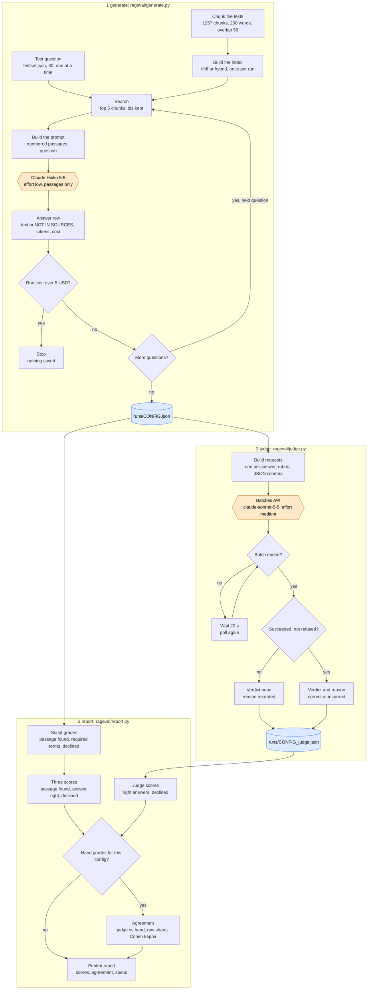

# Architecture of rag-eval

Two diagrams: how the files fit together, and what happens in one evaluation run. Both match
the code as of the commit that added this file. Line numbers refer to that commit.

## (a) Structure: files, external services, data files

How to read it: a solid arrow is an import or a call. A thick arrow is a call to something
outside the repo. A dotted arrow is a file read or written. Orange hexagons are external
services or libraries, cylinders are data files.

```mermaid
flowchart TD
    subgraph ENTRY["Entry points"]
        run["run.py<br/>CLI, dispatch, download, generate, judge, all"]
        verify["verify.py<br/>offline checks, no API, PASS or FAIL"]
    end

    subgraph RAGEVAL["rageval/"]
        config["config.py<br/>models, prices, paths, CONFIGS, key check"]
        generate["generate.py<br/>retrieve, prompt, answer, spend cap"]
        judge["judge.py<br/>rubric, JSON schema, batch, verdicts"]
        report["report.py<br/>three scores, kappa, spend"]
    end

    subgraph PIPELINE["pipeline/"]
        sources["sources.py<br/>3 CELEX ids, EUR-Lex url"]
        download["download.py<br/>HTML to plain text"]
        chunk["chunk.py<br/>200 words, 50 overlap, chunk ids"]
        version_a["version_a.py<br/>TF-IDF, numpy, cosine top k"]
        version_b["version_b.py<br/>bge-small embeddings, cosine top k"]
        hybrid["hybrid.py<br/>RRF, k 60, depth 50"]
    end

    eurlex{{"EUR-Lex<br/>HTTP download, 3 legal texts"}}
    haiku{{"Claude Messages API<br/>claude-haiku-5-5, effort low"}}
    batchapi{{"Claude Message Batches API<br/>claude-sonnet-5-5, half price, polling"}}
    fastembed{{"fastembed library<br/>ONNX, BAAI bge-small, CPU"}}

    env[(".env<br/>API key, git-ignored")]
    raw[("data/raw<br/>EUR-Lex HTML, git-ignored")]
    text[("data/text<br/>plain text, 3 files, git-ignored")]
    testset[("testset.json<br/>40 questions, 29 answerable, 11 not")]
    hand[("hand_grades.json<br/>24 baseline grades, reasons")]
    runs[("runs/CONFIG.json<br/>answers, retrieved ids, tokens, cost")]
    judgeruns[("runs/CONFIG_judge.json<br/>verdicts, batch id, cost")]
    known[("verify_known_good.json<br/>1257 chunks, known misses")]

    run --> config
    run --> report
    run --> download
    run --> generate
    run --> judge

    generate --> config
    generate --> chunk
    generate --> version_a
    generate --> hybrid
    hybrid --> version_a
    hybrid --> version_b
    judge --> config
    report --> config
    report --> chunk
    download --> sources

    verify --> config
    verify --> download
    verify --> chunk
    verify --> version_a
    verify --> hybrid
    verify --> generate
    verify --> judge
    verify --> report

    download ==> eurlex
    generate ==> haiku
    judge ==> batchapi
    version_b ==> fastembed

    config -.-> env
    download -.-> raw
    download -.-> text
    chunk -.-> text
    generate -.-> testset
    generate -.-> runs
    judge -.-> testset
    judge -.-> runs
    judge -.-> judgeruns
    report -.-> testset
    report -.-> runs
    report -.-> judgeruns
    report -.-> hand
    verify -.-> testset
    verify -.-> raw
    verify -.-> known

    classDef ext fill:#fde8c8,stroke:#b36b00,color:#000
    classDef data fill:#dbeafe,stroke:#2563eb,color:#000
    class eurlex,haiku,batchapi,fastembed ext
    class env,raw,text,testset,hand,runs,judgeruns,known data
```

### Boxes

| Box | `file:line` of the main function | What it does |
|---|---|---|
| run.py | `run.py:17` (the `__main__` dispatch) | Reads the command (report, download, generate, judge, all) and calls the matching module. |
| verify.py | `verify.py:197` (`main`) | Runs the offline checks step by step and prints `verify: PASS` or the first failure. It never calls the Claude API. |
| config.py | `rageval/config.py:64` (`cost_usd`) | Holds the model ids, prices, paths and the two configs (`CONFIGS`, line 29), reads `.env` (line 38) and stops before a paid call if no key is set (line 55). |
| generate.py | `rageval/generate.py:66` (`main`) | For each test question, finds the top 5 chunks, asks Claude Haiku to answer from them only, and saves the run. |
| judge.py | `rageval/judge.py:70` (`main`) | Sends every answer to Claude Sonnet as a batch of grading requests and saves one verdict per question. |
| report.py | `rageval/report.py:71` (`main`) | Prints the three scores per config, the judge scores, the agreement with the hand grades and the spend, with no model call. |
| sources.py | `pipeline/sources.py:27` (`url`) | Lists the three EU texts by CELEX number and builds the EUR-Lex address for each. |
| download.py | `pipeline/download.py:46` (`main`) | Downloads each text once and turns the HTML into plain text, one line per block. |
| chunk.py | `pipeline/chunk.py:33` (`load_chunks`) | Cuts each text into overlapping 200 word windows (`chunk_text`, line 24) with ids like `csrd#0042`. |
| version_a.py | `pipeline/version_a.py:23` (`TfidfIndex`) | Keyword search: scores every chunk by TF-IDF cosine similarity to the question, written by hand in numpy. |
| version_b.py | `pipeline/version_b.py:15` (`EmbeddingIndex`) | Meaning search: scores every chunk by cosine similarity of bge-small embeddings. |
| hybrid.py | `pipeline/hybrid.py:17` (`HybridIndex`) | Runs both searches and merges the two rankings with reciprocal rank fusion. |
| EUR-Lex | `pipeline/download.py:52` (`urlopen`, line 53) | The public site the three legal texts are downloaded from. |
| Claude Messages API | `rageval/generate.py:45` (`messages.create`) | Answers one question from the passages it is given, or replies `NOT IN SOURCES`. |
| Claude Message Batches API | `rageval/judge.py:77` (`batches.create`) | Grades all answers in one batch at half price and returns the results later. |
| fastembed library | `pipeline/version_b.py:17` (import, model built at line 19) | Runs the embedding model on the CPU. |
| .env | `rageval/config.py:38` (`load_dotenv`) | Local file with the API key, never committed. |
| data/raw | `pipeline/download.py:54` | The downloaded HTML, kept so a text is fetched only once. |
| data/text | `pipeline/download.py:56` | The plain text the chunks are cut from. |
| testset.json | `rageval/generate.py:70` | The 40 questions with reference answers, required terms and accepted evidence. |
| hand_grades.json | `rageval/report.py:76` | The author's grades for 24 baseline answers, used to check the judge. |
| runs/CONFIG.json | `rageval/generate.py:96` | One generation run: retrieved chunk ids, answer, tokens and cost per question. |
| runs/CONFIG_judge.json | `rageval/judge.py:109` | One judge run: a verdict and reason per question, tokens, cost and batch id. |
| verify_known_good.json | `verify.py:22` | The chunk count and the known retrieval misses that `verify.py` compares against. |

## (b) Pipeline: one evaluation run, question to score

One run is one config (`baseline` or `hybrid`) through `python run.py generate CONFIG`,
`python run.py judge CONFIG` and `python run.py`. The only branches are the spend cap, the
batch wait, failed judge results and whether hand grades exist.

### Steps

| Box | `file:line` of the main function | What it does |
|---|---|---|
| Test question | `rageval/generate.py:70` (loop at line 75) | Loads the 40 questions and takes them one at a time. |
| Chunk the texts | `rageval/generate.py:69` calling `pipeline/chunk.py:33` | Cuts the three texts into 1257 overlapping chunks. |
| Build the index | `rageval/generate.py:26` (`build_index`) | Builds the TF-IDF index, or the TF-IDF plus embedding index, over all chunk texts. |
| Search | `rageval/generate.py:76` calling `pipeline/version_a.py:46` or `pipeline/hybrid.py:22` | Returns the 5 best chunks for the question and keeps their ids. |
| Build the prompt | `rageval/generate.py:38` (`prompt`) | Numbers the 5 passages and appends the question. |
| Claude Haiku 5.5 | `rageval/generate.py:43` (`answer`, call at line 45) | Answers from the passages only, or replies `NOT IN SOURCES`. |
| Answer row | `rageval/generate.py:78` (row built, answer merged at line 79) | Keeps the answer, token counts, cost and seconds for the question. |
| Run cost over 5 USD? | `rageval/generate.py:81` | Stops the whole run, saving nothing, if the cost so far passes `MAX_RUN_USD`. |
| More questions? | `rageval/generate.py:75` | Moves on to the next question until all 30 are answered. |
| runs/CONFIG.json | `rageval/generate.py:96` | Writes the run: config, model, totals and one row per question. |
| Build requests | `rageval/judge.py:53` (`build_requests`) | Makes one grading request per answer, with the rubric and the reference answer or the reason it is unanswerable. |
| Batches API | `rageval/judge.py:77` | Sends all requests at once to Claude Sonnet. |
| Batch ended? | `rageval/judge.py:79` | Checks the batch status. |
| Wait 20 s | `rageval/judge.py:84` | Sleeps `poll_seconds` and asks again. |
| Succeeded, not refused? | `rageval/judge.py:88` and `:94` | Marks a request whose result failed or was refused as having no verdict. |
| Verdict none | `rageval/judge.py:89` and `:95` | Stores `None` with the reason, so the failure is counted and not hidden. |
| Verdict and reason | `rageval/judge.py:97` | Reads the JSON verdict (correct or incorrect) and one sentence of reason. |
| runs/CONFIG_judge.json | `rageval/judge.py:109` | Writes verdicts keyed by question id, with tokens, batch price and batch id. |
| Script grades | `rageval/report.py:39` (`script_grades`) | Checks, with no model, whether an accepted evidence passage is in the retrieved chunks, whether the answer has every required term, and whether it declined. |
| Three scores | `rageval/report.py:86` | Counts passage found and answer right over the answerable questions in the run, and declined over the unanswerable ones. |
| Judge scores | `rageval/report.py:102` | Counts the questions the judge marked correct, per group. |
| Hand grades for this config? | `rageval/report.py:108` | Runs the agreement step only if `hand_grades.json` has grades for the config. |
| Agreement | `rageval/report.py:62` (`agreement`, `kappa` at line 54) | Compares judge and hand grades, and script and hand grades: share that match and Cohen's kappa. |
| Printed report | `rageval/report.py:71` (`main`) | Prints the scores, the agreement and the measured spend. |
